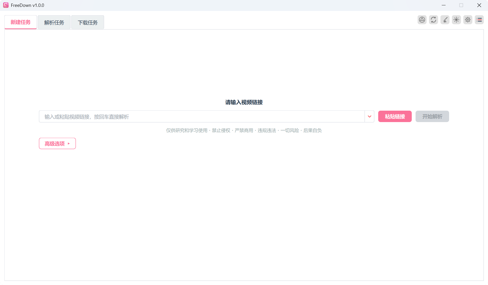
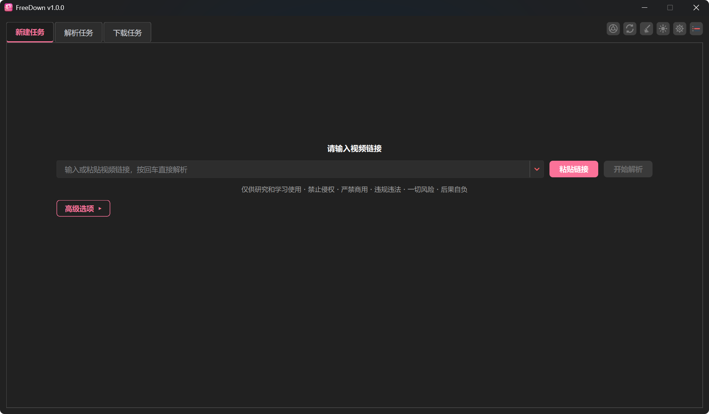
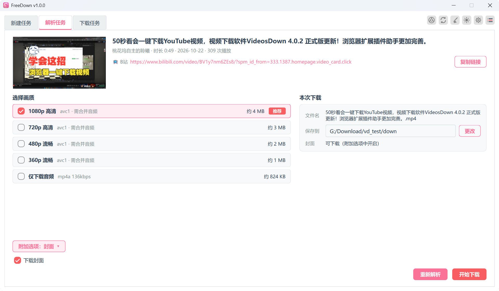
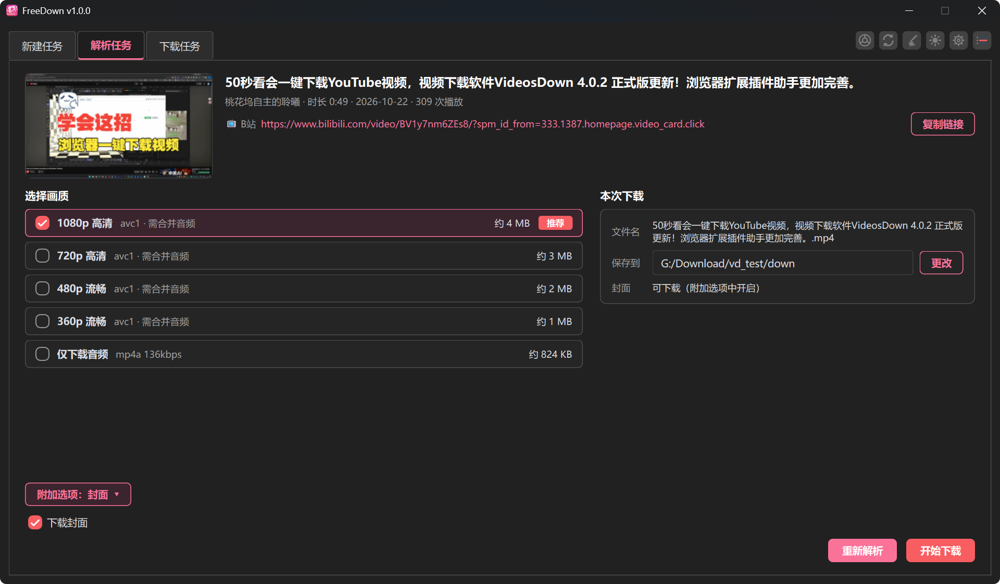
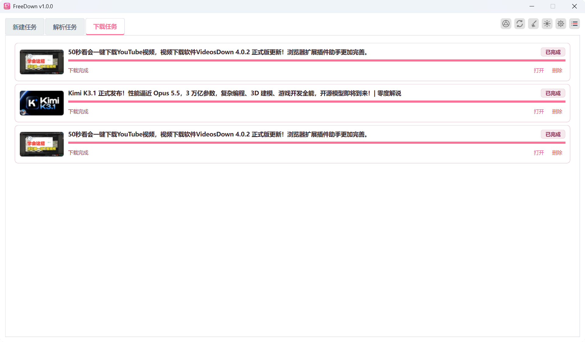
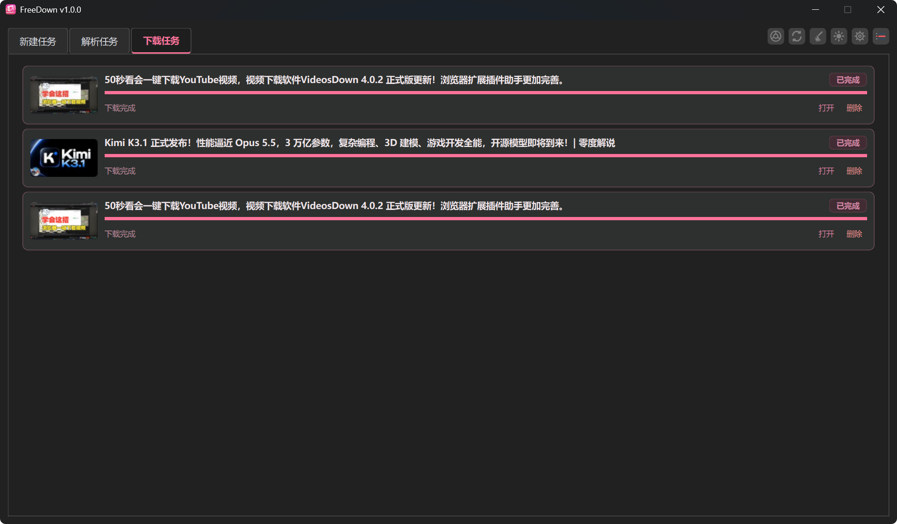

# FreeDown

[English](../../README.md) | [简体中文](./README.zh-CN.md) | [繁體中文](./README.zh-TW.md) | **日本語** | [한국어](./README.ko.md)


[yt-dlp](https://github.com/yt-dlp/yt-dlp) と FFmpeg を基盤に構築された、無料の **bilibili 専用**動画ダウンローダー。

> 本プロジェクトは VideosDown（バージョン 4.0.0）から派生したばかりです。現在は**無料インストーラーを先行公開**しており、完全なソースコードは後日 [GPL-3.0](../../LICENSE) で公開予定です。

## ✨ 主な機能

- **bilibili 専用**：BV/AV 単体動画、番組、マルチパート選択（`?p=N`）、公式短縮リンク `b23.tv`
- **画質選択**：解析結果から解像度を選択。ログインで高解像度も選択可能
- **カバー画像ダウンロード**：動画と一緒にカバー画像を保存
- **Cookie 認証**：大会員・高解像度のログイン状態に対応（Firefox からの自動取得／cookies.txt の手動インポート）
- **ローカル動画トランスコード**：FFmpeg による変換、GPU アクセラレーション対応
- **ライト／ダークテーマ**：bilibili ピンクのテーマカラー、システム言語に追従
- **サイトガード**：許可するドメインは bilibili のみ（ソルト付きハッシュのホワイトリスト＋解析・ダウンロード全体での多段強制チェック）
## 🖼 スクリーンショット

| ☀️ ライト | 🌙 ダーク |
|:---:|:---:|
|  |  |
|  |  |
|  |  |

## 🚀 ダウンロードとインストール（無料）

[Releases](https://github.com/zlingxi/FreeDown/releases) からインストーラーを入手してください：

- **Windows**：`FreeDown-<バージョン>-Windows-x64.exe`
- **macOS**：`FreeDown-<バージョン>-MacOS-arm64.dmg`（**Apple Silicon / M シリーズチップ専用**）

> 無料公開の段階では上記 2 プラットフォームのみの提供で、Intel チップの Mac には現在対応していません。

> ⚠️ **注意**：動画プラットフォームは API を予告なく変更する場合があり、解析・ダウンロード機能が使えなくなることがあります。その場合は [Releases ページ](https://github.com/zlingxi/FreeDown/releases) に注目し、最新版へ早めに更新してください。

## 🧪 ソースコード公開（近日予定）

ソースコードは準備中で、まもなく本リポジトリにて GPL-3.0 で公開されます。公開後はソースから実行できます：

```bash
git clone https://github.com/zlingxi/FreeDown.git
cd FreeDown
uv sync
uv run freedown.py
```

動作環境：Python ≥ 3.14、[uv](https://docs.astral.sh/uv/) の利用を推奨。

## 📦 ビルド

```bash
# Windows（Inno Setup が必要）/ macOS（create-dmg が必要）
uv run build_app.py
```

## 🗂 ディレクトリ構成

```
freedown.py            # エントリポイント
app/
  parse/               # サイトガード + URL 分類 + 解析オーケストレーション
  interface/           # メイン UI：新規／解析／ダウンロード／トランスコード
  page/                # 設定、ツールボックスなどのダイアログ
  common/              # ダウンロードコア、アップデート、テーマ、ログなど
  thread/              # QThread ワーカー
  widgets/             # 再利用可能なウィジェット
  resources/           # QSS / アイコン / ffmpeg
tools/                 # リリース補助スクリプト
```

## ⚠️ 免責事項

本ソフトウェアは学習および研究目的のみに提供されます。ダウンロードしたコンテンツの著作権は原著作者に帰属します。有料・会員コンテンツには本人アカウントのログイン状態が必要です。営利目的や権利侵害を伴う配布は固く禁じます。詳細はアプリ内の「免責事項」ページをご覧ください。

## 📄 ライセンス

[GPL-3.0](../../LICENSE) © 2026 FreeDown contributors。VideosDown（4.0.0 より前のバージョンは MIT ライセンス）から派生しています。補足：

- 本プロジェクトをフォークして対応サイトの範囲を変更した場合、その行為と責任はすべて変更者自身に帰属し、本プロジェクトは関与しません；
- ダウンロードしたコンテンツの著作権は原著作者に帰属し、本ソフトウェアは学習・研究目的のみに使用してください；
- 依存するサードパーティのオープンソースコンポーネント（yt-dlp、FFmpeg、PySide6 など）のライセンスと著作権はそれぞれの作者に帰属します。
